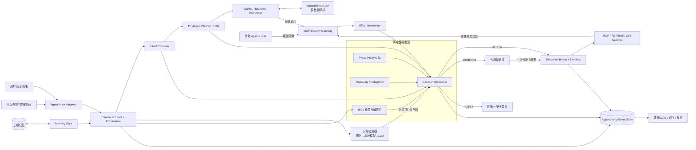
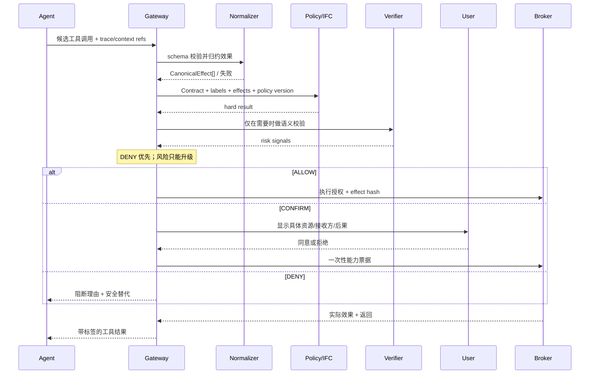

# CAMEL 二次优化开发架构与实施计划

> 状态：规划基线（2026-10-14）  
> 适用对象：本仓库 `camelplus`（CaMeL：*Defeating Prompt Injections by Design*），不是 CAMEL-AI 多智能体框架。  
> 论文编号均指向 [ref.md](./ref.md)。

## 1. 结论

建议将现有研究原型演进为 **CaMeL Core + Agent Hook + MCP Security Gateway + Execution Broker** 的混合防御系统：

- 保留 CaMeL 的可信规划器、隔离 LLM、受限解释器和值级来源/读者标签 [R01]；
- 以独立 Gateway/Broker 完整中介所有外部效果，避免 Agent 绕过解释器直接访问 MCP、文件、Shell 或网络；
- 用 Intent Contract、工具依赖图和语义校验提高可用性，但不把任何 LLM 判定当作最终安全边界 [R04][R05][R06]；
- 用确定性信息流控制、最小权限策略和短期能力票据作最终裁决 [R02][R03][R15][R17]；
- 用来源 DAG 贯穿工具返回、子 Agent 和长期记忆，支撑阻断、解释与溯源 [R16][R19]；
- 用 AgentDojo、ASB、MSB 和自适应攻击集同时衡量安全、任务效用、误报和时延 [R11][R12][R13][R14]。

这不是“检测到恶意文本才安全”的系统。核心目标是：即使检测器和底层 LLM 被绕过，未获授权的外部效果仍不能执行。

## 2. 目标、非目标与威胁模型

### 2.1 目标

1. 覆盖直接注入、间接注入、MCP 工具投毒、记忆污染、工具滥用和跨 Agent 传播。
2. 对每次外部效果给出 `ALLOW / CONFIRM / DENY`，并输出可复核理由。
3. 保留参数级来源、敏感性、授权范围和派生关系，生成攻击 DAG 与时序链。
4. 兼容现有 Python 代码和 AgentDojo，逐步增加 MCP、文件、Shell、Git、网络适配器。
5. 在检测模型失效时仍保持机密性、完整性和授权非扩张不变量。

### 2.2 非目标

- 不承诺识别所有恶意自然语言；开放世界中的“恶意语义”不存在可靠完备分类器。
- 不把模型的思维链作为可信审计证据；只记录结构化计划、工具参数、返回和系统决策。
- 不在第一阶段构建通用微服务平台、复杂图数据库或自研训练管线。
- 不声称信息流、能力、来源图或任务对齐机制为本项目首创；对应先例见 `ref.md`。

### 2.3 攻击者能力

攻击者可控制用户输入、网页/邮件/文档/代码内容、MCP 工具描述或返回、部分长期记忆及子 Agent 消息；可进行 Unicode、编码、多语言、分片、多轮和自适应变换。攻击者不能修改可信计算基中的策略引擎、Gateway、Broker、审计签名密钥和宿主隔离配置。

### 2.4 可信计算基（TCB）

TCB 只包括：

- 请求入口和身份鉴别；
- 标签/来源传播内核；
- Effect Normalizer；
- 确定性 Policy Engine 与 Decision Composer；
- MCP Gateway、Execution Broker 和沙箱配置；
- 确认票据签发与校验；
- 追加式审计存储。

LLM、向量库、第三方 MCP Server、外部内容和普通 Agent 进程都不属于 TCB。

## 3. 安全不变量

```text
I1  hard_decision == DENY  => final_decision != ALLOW

I2  Authority(child) ⊆ Authority(parent) ∩ IntentContract

I3  低完整性内容可提供数据，不得创建目标、扩大权限或改变接收方

I4  confidentiality(value) > clearance(destination)
    => value 不得流向 destination

I5  每个已执行外部效果都必须有未过期的授权路径、策略版本和审计事件

I6  规范化失败 + 高影响效果 => DENY；网关/策略服务故障 => 高风险路径 fail closed

I7  detector/verifier 只能把风险向 CONFIRM/DENY 提升，不能覆盖硬规则的 DENY
```

## 4. 总体架构



### 4.1 为什么采用混合架构

| 单一方案 | 主要缺口 | 本方案补偿 |
|---|---|---|
| 仅提示注入分类器 | 可被自适应改写绕过，且误报会损害效用 [R14] | 分类器仅提供风险信号；硬边界由策略和沙箱负责 |
| 仅 CaMeL 解释器 | 研究代码只保护经解释器调用的工具；真实 Agent 可有旁路 | MCP Gateway 与 Broker 完整中介真实效果 |
| 仅 MCP Gateway | 看不到可信用户意图、计划、内存来源；`exec` 可产生二阶效果 | Hook 提供意图，Normalizer 展开实际效果，Broker 限制 OS/网络 |
| 仅 LLM Judge | 非确定、可注入、难复现 | 只用于歧义风险升级；不可降级硬规则 |
| 仅静态白名单 | 无法表达参数、来源、接收方和跨步数据流 | Typed DSL + IFC + 能力票据 |

## 5. 核心数据模型

模型先保持小而稳定，使用 Pydantic v2 定义并生成 JSON Schema；跨进程事件使用版本化 JSON。禁止在组件之间传递无版本的自由格式字典。

### 5.1 `TrustLabel`

```yaml
provenance: [evt_web_17, evt_tool_04]
integrity: untrusted       # trusted_user | trusted_system | verified | untrusted
confidentiality: secret   # public | internal | confidential | secret
authority: data_only      # data_only | propose | execute:<scopes>
readers: [principal:alice, service:corp-mail]
```

标签的合并默认只会降低完整性、提高机密性、收窄 authority/readers。解密级、背书和扩权是显式特权操作，必须记录主体、理由和策略版本。

### 5.2 `IntentContract`

```yaml
contract_id: ic_01
principal: user:alice
goal: review_current_repository
allowed_effects:
  - effect: READ
    resource: repo://current/**
forbidden_data_classes: [credential, private_key]
allowed_destinations: []
side_effect_budget: 0
delegation:
  allowed: true
  max_depth: 1
  child_ceiling: [READ_REPO]
expires_at: 2026-10-14T12:30:00Z
```

Intent Compiler 只读取可信用户消息与组织策略。外部内容只能作为事实进入计划，不能修改 Contract。低置信度编译结果必须确认后才生效。

### 5.3 `CanonicalEffect`

```yaml
effect_id: fx_01
type: EGRESS               # READ | WRITE | EXEC | EGRESS | REPO_MUTATE |
                           # DELEGATE | MEMORY_READ | MEMORY_WRITE | AUTH_CHANGE
operation: http_post
resources: [file://workspace/.env]
data_refs: [value://secret_17]
destination: https://example.invalid/upload
reversibility: irreversible
required_capabilities: [READ_SECRET, NET_EGRESS]
derived_from: [evt_tool_04]
normalization_confidence: exact
```

策略不直接依赖供应商工具名，而依赖规范效果。一个工具调用可以展开为多个效果，例如 Shell 管道可同时产生 `READ + EXEC + EGRESS`。

### 5.4 `Decision`

```yaml
decision: DENY
hard_reasons: [secret_to_untrusted_egress]
risk_signals: [indirect_instruction, intent_drift]
policy_version: sha256:...
contract_id: ic_01
evidence: [evt_web_17, evt_tool_04, fx_01]
safe_alternative: redact_then_send
```

### 5.5 `CanonicalEvent`

每条事件至少包含 `event_id / trace_id / session_id / parent_ids / principal / source / payload_ref / span_map / labels / timestamp / schema_version`。原始文本可记录字符或 token span；经总结、翻译、OCR 或 LLM 改写后只记录派生关系及置信度，不伪称精确 token 因果。

## 6. 组件与技术选择

### 6.1 Ingress 与输入规范化

责任：接入用户、工具、文档、记忆和子 Agent 消息；保留原文；生成规范化视图与来源标签。

选择：

- Unicode NFKC、零宽/控制字符标记、全半角统一、可逆解码预算、MIME/文件类型识别；
- 原文与规范化文本并存，策略匹配规范化文本，取证引用原文；
- 结构化字段与不可信正文使用不同通道，必要时采用 Spotlighting/结构化查询作为软防线 [R08][R09]；
- 解码递归设层数和输出大小上限，避免压缩炸弹及指数展开。

失败策略：解析失败不丢弃来源；涉及可执行、高权限或外发的未知格式进入 `CONFIRM` 或 `DENY`。

### 6.2 Intent Compiler 与计划图

责任：从可信请求编译 Intent Contract，并生成工具依赖图（TDG）。

选择：

- 沿用 CaMeL 的 Privileged LLM 生成结构化程序，但输出先编译为受限 IR，而不是直接视为授权 [R01]；
- TDG 节点包含工具类、输入来源约束、允许效果和前置条件；参考 IPIGuard 的“先规划、后接触不可信数据” [R05]；
- Task Shield 风格逐步检查动作是否服务用户目标 [R04]；
- 计划可以因工具结果补充参数，不能由不可信结果新增高权限分支；确需扩权时重新请求用户确认。

不选择“纯 embedding 相似度”作为意图对齐：语义相似不等于授权一致，且无法表达资源、接收方和副作用预算。

### 6.3 CaMeL Restricted Interpreter 与 Quarantined LLM

责任：执行受限 IR、传播值级 metadata，并把不可信自然语言解析限制在无工具权限的隔离模型中。

选择：

- 保留现有 `interpreter/`、`CaMeLValue`、`Capabilities` 和 `query_quarantined_llm`；
- 新增 IR 版本与允许语法清单，禁止动态导入、反射、任意属性访问和宿主 Python 对象逃逸；
- 每个 builtin 明确纯度与效果；未知函数默认有副作用并拒绝；
- 解释器负责求值，不直接拥有外部凭据；实际调用交给 Gateway/Broker。

### 6.4 Effect Normalizer

责任：把 MCP、文件、Shell、Git、网络、记忆与委派调用归约为 `CanonicalEffect[]`。

选择：

- 路径：绝对化、`realpath`、符号链接边界和工作区根校验；实际打开由 Broker 使用安全句柄，避免检查后替换；
- Shell：使用 AST 解析管道、重定向、子命令、解释器、编码解码与“下载后执行”；不以正则解析 Shell；
- 网络：规范化 scheme/host/port/IP，解析重定向，拦截私网、metadata endpoint、DNS rebinding 和非授权 egress；
- Git：区分只读、工作区修改、commit、remote 修改、push；
- MCP：固定 server/tool/schema digest，调用参数按声明 schema 验证；
- 无法可靠归约的动态命令，在高影响场景 fail closed。

这是首个应独立高覆盖测试的模块，因为上层策略只对规范化结果负责。

### 6.5 Policy Engine、IFC 与能力票据

责任：执行确定性授权、机密性/完整性信息流和最小权限约束。

选择：

- 用小型、强类型、默认拒绝的 YAML DSL，经 Pydantic 编译成纯谓词；语义参考 Progent [R03]；
- 标签传播采用机密性与完整性双维格，基础来自 DIFC，并结合 Fides 对 Agent 的动态污点跟踪 [R02][R15]；
- 用户确认签发绑定 `subject + exact effect hash + resource + destination + expiry + max_uses` 的不可转移票据；能力理念参考 Capsicum [R17]；
- 首版不引入 OPA/Cedar 服务依赖；当策略数量、组织复用或多语言 SDK 确有需求时再增加适配层。

策略示例：

```yaml
id: deny-secret-egress
when:
  effect.type: EGRESS
  any_data.confidentiality_at_least: secret
  destination.trust_not_in: [corp]
then: DENY

---
id: confirm-repo-push
when:
  effect.type: REPO_MUTATE
  effect.operation: push
  contract.allowed_effect_missing: REPO_PUSH
then: CONFIRM
```

### 6.6 分层检测与语义验证

责任：发现注入、意图漂移、工具描述异常和复杂语义风险；只产生 `RiskSignal`。

选择按成本递增：

1. 确定性规则：格式异常、危险组合、敏感路径/目的地和 schema 变化；
2. 本地分类/embedding：用于候选筛选；若部署白盒模型，可评估 InstructDetector [R20]；
3. 独立 LLM verifier：输入最小必要上下文，输出固定 schema；参考 Task Shield、VIGIL 和 ShieldMCP [R04][R06][R07]。

模型超时、JSON 无效或意见不一致时不返回 `ALLOW`。检测结果必须包含检测器版本、置信度和证据范围，以便回放与阈值校准。

### 6.7 MCP Security Gateway

责任：成为 MCP 注册、发现、调用和返回的唯一通道。

选择：

- 初期用 Python 独立进程实现 stdio 与 Streamable HTTP 代理，复用当前 Pydantic 模型；
- 工具首次信任（TOFU）只适合开发环境；生产必须使用 server identity、允许列表和 schema/description digest；
- 工具描述变化、同名冲突、server 更换、返回内伪造 user/system 角色均产生风险事件；
- 返回值在交给 Agent 前封装来源和标签，并进入检测器与审计；
- 设计依据来自 MCP 专项防御和基准 [R07][R13]。

### 6.8 Memory Gate

责任：控制长期记忆的写入、合并、检索、过期与删除，阻止来源洗白。

选择：

- 记忆条目保存原始来源、写入主体、敏感性、完整性、TTL 和策略版本；
- 内容与 authority 分开存储；摘要/合并继承所有父来源，不会自动升为“用户事实”；
- 写入前检测秘密、指令性文本和越权目标；检索后仍作为不可信数据进入隔离解析器；
- 高风险记忆使用 quarantine 分区，经可信主体背书后才能影响计划；
- AgentPoison 作为主要威胁与回归集来源 [R10]。

首版使用关系库/SQLite 测试实现即可；只有事件规模证明必要时才引入图数据库或向量数据库。

### 6.9 Execution Broker 与沙箱

责任：在 OS 层执行已批准效果，防止策略与实际行为不一致。

选择：

- Agent 进程不持有长期密钥；Broker 按票据注入短期凭据或 opaque handle；
- 文件系统使用只读根、显式可写挂载、独立临时目录和系统调用约束；
- 网络默认拒绝，所有 egress 经过代理并复核实际 DNS/IP、重定向和请求体标签；
- 高风险命令使用容器/轻量 VM，限制 UID、capabilities、seccomp、资源和超时；
- 将 Capsicum 的能力隔离原则用于权限设计 [R17]；ToolEmu 仅用于测试风险，不替代真实沙箱 [R18]。

### 6.10 Provenance、审计与可视化

责任：提供可验证的“谁让什么数据经何路径影响了哪个效果”。

选择：

- 热路径先写本地追加日志/SQLite，生产可迁移 PostgreSQL；DAG 是逻辑模型，不要求首版部署图数据库；
- payload 与 metadata 分离存储，秘密默认只存哈希/密文/受控引用；
- 事件使用哈希链或批次 Merkle root 防止静默修改；
- 用 `trace_id + parent_ids + derived_from` 重建跨 MCP、Agent、会话和记忆链路；
- 来源模型参考经典数据 provenance [R16]，多 Agent 语义传播参考 SafeFlow [R19]。

## 7. 固定决策流程



判定优先级固定如下：

1. 身份、schema、规范化失败检查；
2. 组织硬禁令；
3. 机密性/完整性 IFC；
4. Intent Contract 与能力范围；
5. 状态/序列约束（速率、预算、跨步危险组合）；
6. 语义风险信号；
7. 合并结果：任一硬 `DENY` 即 `DENY`；否则风险超过确认阈值为 `CONFIRM`；其余 `ALLOW`。

## 8. 关键数据流

### 8.1 间接注入导致凭据外发

1. 网页进入 Ingress，标记 `integrity=untrusted`，检测器发现指令片段。
2. Quarantined LLM 可抽取网页事实，但不能调用工具或修改 Contract。
3. Agent 提议读取 `.env` 并 HTTP POST；Normalizer 产生 `READ(secret)` 与 `EGRESS(secret, external)`。
4. IFC 命中秘密到非信任接收方，硬 `DENY`；检测器是否识别攻击不影响结果。
5. 审计 DAG 连接网页 span、计划分支、文件引用、目的地和拒绝策略。

### 8.2 合法 Git 检视被诱导 push

1. Intent Contract 只含 `READ_REPO`，副作用预算为 0。
2. Git adapter 将候选调用展开为 `REPO_MUTATE(push)`。
3. Contract 不含 `REPO_PUSH`，Decision Composer 返回 `CONFIRM` 或按组织策略 `DENY`。
4. 用户确认时只签发绑定具体 remote、branch、commit hash 的单次票据，不能复用到其他仓库。

### 8.3 记忆污染跨会话触发

1. 不可信 Issue 被写入记忆时保留来源与 `data_only` authority。
2. 下次会话检索结果不会被重标为用户指令。
3. 若该记忆影响高权限参数，完整性规则拒绝；Provenance DAG 跨 session 保留因果路径。

### 8.4 MCP rug pull

1. Gateway 注册时保存 server identity、工具 schema 与描述 digest。
2. 后续发现描述/schema/服务身份变化，暂停工具并产生 `tool_manifest_changed`。
3. 管理员重新审核前不得自动继承旧授权；已签发票据绑定旧 digest，因此失效。

## 9. 目标代码结构与迁移关系

```text
camelplus/
  src/camel/
    core/                 # TrustLabel、IntentContract、Effect、Decision、Event
    interpreter/          # 现有解释器：只做受限求值和 metadata 传播
    planner/              # privileged planner、IR、TDG、contract compiler
    normalization/        # fs/shell/net/git/mcp effect adapters
    policy/               # typed DSL、IFC、capability ticket、decision composer
    detection/            # 规则、本地模型、LLM verifier 适配器
    gateway/              # MCP stdio/HTTP proxy
    memory/               # Memory Gate
    broker/               # 沙箱执行、凭据代理、egress
    audit/                # event store、DAG query、report
    adapters/agentdojo/   # 将当前 AgentDojo 专用逻辑移出核心
  tests/
    unit/                 # 纯函数、schema、传播与策略表驱动测试
    integration/          # gateway/broker/memory/adapter
    adversarial/          # 注入、混淆、组合、跨会话、自适应攻击
    regression/           # 每个已修漏洞一个最小复现
```

迁移原则：先新增稳定模型和适配层，再移动旧代码；不一次性重写解释器。现有映射如下：

| 当前模块 | 去向 |
|---|---|
| `capabilities/*` | 扩展为 `core/labels.py`，保留兼容转换 |
| `security_policy.py` | 收敛到 `policy/engine.py`，二态结果升级三态 |
| `pipeline_elements/privileged_llm.py` | 拆分为 planner、interpreter runner、AgentDojo adapter |
| `quarantined_llm.py` | 保留并增加无网络/无工具运行配置与结构化审计 |
| `pipeline_elements/security_policies/*` | 转成 DSL fixture，作为兼容性测试 |
| `models.py` | 只负责模型 provider，不再组装所有安全逻辑 |

## 10. 实施计划

每阶段只有在验收门槛通过后进入下一阶段；工期按 2–4 名工程师估算。

| 阶段 | 周期 | 交付 | 可验证出口条件 |
|---|---:|---|---|
| 0. 基线冻结 | 1 周 | 固定依赖、复现实验、威胁模型、基线报告 | 现有 pytest/ruff/pyright 通过；AgentDojo utility/security 可复现 |
| 1. 核心模型与裁决 | 2 周 | Event/Label/Contract/Effect/Decision；三态组合器；DSL v0 | 不变量 I1–I7 有单测/性质测试；旧策略可转换 |
| 2. Gateway 与规范化 | 2 周 | MCP stdio/HTTP 代理；fs/shell/net/git adapters | 所有测试工具调用经 Gateway；危险路径/管道/重定向用例被正确归约 |
| 3. Broker 与确认 | 2 周 | 沙箱、egress、一次性票据、确认 UI/API | 绕过解释器的直接调用仍受阻；票据不可跨主体/效果复用 |
| 4. 语义与记忆 | 2 周 | TDG、Task verifier、分层检测、Memory Gate | 检测失败不破坏硬不变量；跨会话 provenance 可回放 |
| 5. 评测与加固 | 2 周 | AgentDojo/ASB/MSB、自适应攻击、性能与消融 | 达成下述质量门槛；报告可由固定命令再生成 |

### 10.1 MVP（阶段 0–3）必须演示

- 读取普通仓库文件正常放行；
- 写 `~/.ssh/`、`~/.aws/`、自启动位置直接拒绝；
- `curl | sh`、base64 解码执行、命令替换可被 Effect Normalizer 识别；
- 本地秘密向非信任域名外发直接拒绝；
- “仅检视代码”任务触发 `git push` 时确认/拒绝；
- MCP 描述变更导致旧授权失效；
- 每个决定能展示 contract、effect、命中策略和来源路径。

### 10.2 质量指标

| 类别 | 指标 | 阶段 5 目标 |
|---|---|---:|
| 安全 | 硬策略违规执行率 | 0（在声明覆盖范围内） |
| 安全 | AgentDojo / MSB attack success rate | 相对无防御显著下降，报告置信区间 |
| 效用 | benign task completion | 相对当前 CaMeL 基线下降不超过 5 个百分点 |
| 可用性 | benign confirm rate | < 10%，按效果类别拆分 |
| 来源 | 参数级 provenance precision/recall | ≥ 95%（合成真值集） |
| 性能 | 规则/IFC 决策 P95 | < 20 ms（不含模型调用） |
| 性能 | Gateway 总 P95 增量 | < 150 ms（不含外部 LLM verifier） |
| 稳定性 | 决策重放一致率 | 100%（固定策略/模型输出时） |

数值是研发门槛，不是当前实测结论。模型型检测器另报 ROC/PR、跨语言、跨攻击族与校准误差，禁止只报 accuracy。

## 11. 验证策略

### 11.1 测试金字塔

- 单元：标签 join、票据校验、决策优先级、路径/URL/Shell 规范化；
- 性质测试：authority 不扩张、秘密不流向低 clearance、硬拒绝不可被覆盖；
- 差分测试：原始调用与规范效果在允许环境中的实际效果一致；
- 集成：Hook → Gateway → Broker → 返回标签 → 审计；
- 对抗：多语言、Unicode、分片、多轮、编码、长上下文、工具描述/返回投毒；
- 自适应：攻击者知道检测器和策略，针对完整系统优化 [R14]；
- 故障注入：策略服务超时、审计写失败、DNS 改变、MCP 重连、LLM 无效 JSON。

### 11.2 必做消融

分别关闭输入检测、Task verifier、IFC、Intent Contract、Gateway、Memory Gate 和 Sandbox，比较 ASR、效用、确认率、时延。目标是证明哪些组件提供安全边界，哪些只改善检测或效用。

### 11.3 发布门禁

```bash
uv run ruff check
uv run ruff format --check
uv run pyright
uv run pytest
```

此外必须运行固定种子的 AgentDojo 回归、Effect Normalizer 攻击语料、策略快照重放和依赖/SBOM 扫描。任何安全修复都先加入最小复现，再修复，再保留为回归测试。

## 12. 开发规范（Karpathy 风格）

### 12.1 开工前

每个变更在 issue/PR 首部写四项：

1. 问题：现有行为和风险；
2. 假设：信任边界、输入范围、不会处理的情况；
3. 最小方案：需要修改的模块与不修改的模块；
4. 验收：能自动验证的成功/失败样例和指标。

存在两种合理解释且会改变安全语义时必须先澄清，不静默选择。

### 12.2 简单优先

- 为当前需求写最少代码；单一实现不要预建插件框架；
- 优先纯函数、显式数据模型和表驱动策略；
- 首版用 SQLite/PostgreSQL 与 JSON 事件，不因“将来可能”引入 Kafka/图数据库；
- 不用 LLM 解决确定性解析、schema 校验或权限比较能解决的问题；
- 第三个真实实现出现后再抽象通用接口。

### 12.3 外科式修改

- 每个 PR 只解决一个可描述问题；不顺手重排或重构无关代码；
- 保持现有 API 的兼容层，迁移完成且有调用证据后再删除；
- 不覆盖用户已有修改；生成文件与人工文件分开；
- 变更新增的未使用代码必须在同一 PR 清理，既有死代码另开 issue。

### 12.4 安全编码约束

- 默认拒绝；异常、超时和未知枚举不得隐式放行；
- 任何外部效果必须先规范化、再裁决、后执行；检查与使用尽量绑定同一安全句柄；
- 日志默认脱敏，不记录 API key、完整 secret、隐式思维链；
- LLM 输出永远按不可信输入处理，并通过严格 schema 验证；
- 策略版本、模型版本、工具 manifest digest 和代码提交必须进入审计事件；
- 安全边界代码禁止可变默认参数、动态 `eval/exec`、宽泛异常吞噬和不受限反序列化。

### 12.5 Definition of Done

一个组件只有同时满足以下条件才算完成：

- 正常、拒绝、边界和故障用例齐全；
- 威胁模型或不变量有对应测试；
- lint、类型检查、单元与集成测试通过；
- 有可观测指标和结构化审计，不含秘密；
- 有性能基线，没有未解释的显著回退；
- 文档说明输入、输出、失败策略和非目标；
- 另一名评审者可以仅凭事件和策略版本重放决定。

## 13. 首轮任务拆分

1. 建立基线：锁定 AgentDojo 版本、模型与随机种子，保存 utility/security/时延。
2. 写 `core` 五个版本化模型和兼容转换，不移动旧实现。
3. 把 `Allowed | Denied` 升级为三态 Decision Composer，先用当前四套策略做黄金测试。
4. 实现 fs/net/shell 三个 Effect Normalizer 及对抗语料；Git/MCP 随后。
5. 构建最小 MCP proxy，使一个示例 server 只能经 proxy 访问。
6. 构建 Broker 的无网、只读工作区 profile，验证直接旁路失败。
7. 加入 scoped confirmation ticket 和完整审计链。
8. 最后接入检测器、TDG 和 Memory Gate；这些模块不得改变硬拒绝语义。

首轮不做大规模模型训练、不切微服务、不引入图数据库。先证明“完整中介 + 规范效果 + 确定性裁决”闭环可运行，再用测量结果决定扩展。
